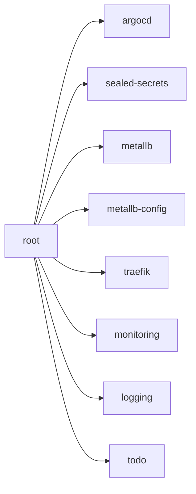

# E2E DevOps Platform — GitOps

[E2E DevOps Platform](https://github.com/MustafaOgur/e2e-devops-platform) projesinin GitOps reposu. Kubernetes cluster'ının istenen durumunu tanımlar: ArgoCD, uygulama, dış erişim, secret yönetimi, izleme ve loglama. Cluster [infra reposu](https://github.com/MustafaOgur/e2e-devops-platform-infra) ile kurulur; üzerindeki her şey bu repodan ArgoCD tarafından uygulanır.

## Mimari



`bootstrap/root.yaml` bir kez elle uygulanır; `apps/` klasöründeki Application'ları oluşturur (app-of-apps). Sonraki her değişiklik Git üzerinden gelir.

```text
Kullanıcı → todo.test (192.168.56.50) → MetalLB → Traefik (Gateway "main") → HTTPRoute
          → /api → backend → PostgreSQL
          → /    → frontend
```

## Uygulamalar

| Application | Kaynak | Namespace | İçerik |
|-------------|--------|-----------|--------|
| `argocd` | `argo-cd` chart 10.17.2 | `argocd` | ArgoCD; kendini bu repodan yönetir |
| `sealed-secrets` | `platform/sealed-secrets` (v0.41.2) | `kube-system` | SealedSecret'ları çözen controller |
| `metallb` | `metallb` chart 0.16.2 | `metallb-system` | LoadBalancer IP'leri (L2) |
| `metallb-config` | `platform/metallb/config` | `metallb-system` | IP havuzu `192.168.56.50–59`, `eth1` üzerinden duyuru |
| `traefik` | `traefik` chart 42.3.2 | `traefik` | Gateway API controller, Gateway `main`, sabit IP `192.168.56.50` |
| `monitoring` | `kube-prometheus-stack` chart 93.2.2 | `monitoring` | Prometheus, Grafana, dashboard'lar, alarm kuralları |
| `logging` | `loki` chart 21.2.3, `alloy` chart 1.16.0 | `logging` | Loki ve her node'da pod loglarını toplayan Alloy |
| `todo` | `manifests/app` | `app` | Uygulama: PostgreSQL, migration Job'ı, backend, frontend, HTTPRoute, HPA, PDB, ServiceMonitor, dashboard, alarm kuralları |

`sealed-secrets`, `metallb` ve `monitoring` sync-wave `-1` ile önce oluşturulur; diğer uygulamalar onların CRD'lerini kullanır.

## Adresler

| Adres | İçerik | Giriş |
|-------|--------|-------|
| http://todo.test | Uygulama | – |
| http://argocd.test | ArgoCD | `admin`, şifre: `kubectl -n argocd get secret argocd-initial-admin-secret -o jsonpath='{.data.password}' \| base64 -d` |
| http://grafana.test | Grafana | `grafana-admin` Secret'ındaki kullanıcı ve şifre |
| Prometheus | Dışarı açık değil | `kubectl port-forward -n monitoring svc/kube-prometheus-stack-prometheus 9090:9090` |

Adreslerin çözülmesi için Windows'ta `C:\Windows\System32\drivers\etc\hosts` dosyasına eklenir:

```text
192.168.56.50 todo.test argocd.test grafana.test
```

## Gereksinimler

| Gereksinim | Not |
|------------|-----|
| Cluster | infra reposundaki k3s kurulumu (Gateway API CRD'leri k3s ile gelir, dahili Traefik ve ServiceLB kapalıdır) |
| `kubectl`, `helm` | Cluster'a erişimi olan yönetim makinesinde |
| `kubeseal` v0.41.2 | Secret'ları şifrelemek için |

## Kurulum

**1. ArgoCD (bir kez):**

```bash
helm repo add argo https://argoproj.github.io/argo-helm
helm install argocd argo/argo-cd --version 10.17.2 \
  -n argocd --create-namespace -f platform/argocd/values.yaml --wait --timeout 10m
```

**2. Kök uygulama (bir kez):**

```bash
kubectl apply -f bootstrap/root.yaml
kubectl get applications -n argocd -w
```

ArgoCD, Helm ile kurulan kendi kaynaklarını sahiplenir ve diğer bütün uygulamaları kurar.

## Secret'lar

Düz secret'lar sadece yerelde, Git'e girmeyen `secrets/` klasöründe tutulur; repoya `kubeseal` ile şifrelenmiş hali girer.

| Secret | Namespace | Anahtarlar | SealedSecret |
|--------|-----------|------------|--------------|
| `postgres` | `app` | `POSTGRES_DB`, `POSTGRES_USER`, `POSTGRES_PASSWORD` | `manifests/app/postgres/sealedsecret.yaml` |
| `backend` | `app` | `DATABASE_URL` | `manifests/app/backend/sealedsecret.yaml` |
| `grafana-admin` | `monitoring` | `admin-user`, `admin-password` | `platform/monitoring/manifests/grafana-admin-sealedsecret.yaml` |

Bir secret'ı oluşturmak veya değiştirmek (örnek: Grafana):

```bash
kubectl create secret generic grafana-admin -n monitoring \
  --from-literal=admin-user=admin --from-literal=admin-password='<şifre>' \
  --dry-run=client -o yaml > secrets/grafana-admin-secret.yaml
kubeseal --format yaml < secrets/grafana-admin-secret.yaml \
  > platform/monitoring/manifests/grafana-admin-sealedsecret.yaml
```

Şifrelenmiş dosya commit edilir; controller onu cluster'da Secret'a çevirir.

## Değişiklik Yapmak

- Değişiklikler PR ile `main`'e girer. ArgoCD `main`'i en geç 3 dakikada bir kontrol eder ve uygular.
- `prune` ve `selfHeal` açıktır: Git'ten silinen kaynak cluster'dan silinir, cluster'da elle yapılan değişiklik geri alınır. İstisnalar: `argocd` ve `sealed-secrets` uygulamalarında `prune` kapalıdır.
- Uygulamanın image etiketlerini uygulama reposundaki Jenkins günceller (`ci: update todo images to <sha>` commit'leri); elle değiştirilmez. Bu repoda çalışmadan önce `git pull` yapılmalıdır.

## Repo Yapısı

```text
bootstrap/root.yaml              Kök Application (bir kez elle uygulanır)
apps/                            ArgoCD Application tanımları
platform/
├── argocd/values.yaml           ArgoCD ayarları ve argocd.test rotası
├── sealed-secrets/              Sealed Secrets controller (resmi YAML)
├── metallb/                     Chart ayarları ve IP havuzu (config/)
├── traefik/values.yaml          Gateway, sabit IP, metrikler, erişim logu
├── monitoring/                  kube-prometheus-stack ayarları; manifests/: Grafana secret'ı, Traefik dashboard'u ve alarm kuralı
└── logging/                     Loki ve Alloy ayarları
manifests/app/                   Uygulama: namespace, postgres/, backend/, frontend/, httproute.yaml
secrets/                         Düz secret'lar (Git'e girmez)
```
